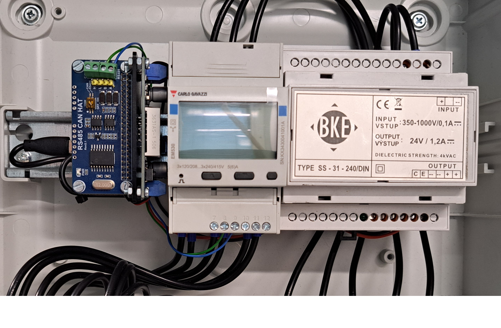

# tuova_energymeter

> ## IMPORTANT!
>
> This repository was created as part of the TUOVA Project (see https://tuova.savonia.fi and https://tuovaproject.github.io/). Some of the information presented here might assume
> familiarity with other repositories created during the course of the project. For more details on those, see the "Additional Information" section at the bottom of this README.
> It is assumed that an InfluxDB database is already deployed.
>
> **Everything is provided as-is, use at your own risk.**
>
> TUOVA Project co-funded by the European Union / Etelä-Savon ELY-keskus.
>
> 

## General

This repository contains a Python application for reading electrical parameters from a Modbus-enabled energy analyzer, and sending
those readings into an InfluxDB database for further processing. The application was designed to run on a Raspberry Pi equipped with a Modbus/RS-485 HAT
(Hardware Attached on Top), but with certain adjustments it would work as well on e.g. a Linux laptop with a USB to RS-485 adapter.

## Example RPi setup

### Components used

- Carlo Gavazzi EM530 energy analyzer with Modbus output
  - see https://www.gavazziautomation.com/fileadmin/images/PIM/DATASHEET/ENG/EM530_DS_ENG.pdf
- 24VDC power supply
  - like this one: https://www.bke.cz/datasheets/30319002/30319002EN.pdf
- Raspberry Pi Zero 2W
  - see https://learn.sparkfun.com/tutorials/getting-started-with-the-raspberry-pi-zero-2-w/all
- Waveshare RS485/CAN HAT
  - see: https://www.waveshare.com/wiki/RS485_CAN_HAT
- Adjustable DC-DC buck converter
  - like one of these: https://thepihut.com/products/20w-adjustable-dc-dc-buck-converter-with-digital-display

It is worth noting that the 24VDC power supply and the DC-DC converter used here are not mandatory for a basic setup, since the Pi can easily be powered
from a wall outlet using a standard 5V USB power supply. In this example, the whole setup was built inside a distribution box without a wall outlet nearby.

### Installation

1. Attach the RS-485 HAT on top of the Pi Zero and check that the module's 120ohm bus termination resistor is enabled (if applicable)
2. Wire the RS-485 HAT's connectors as follows:
   - `A` goes to pin `8` of the EM530 energy analyzer
   - `B` goes to pin `9` of the EM530 energy analyzer
   - (note that `A` and `B` might be the other way around with certain modules/devices, so just swap them if there's no data)

3. Connect the 24VDC output of the power supply to the input side of the DC-DC buck converter
4. Adjust the DC-DC buck converter output to around 5VDC
5. Connect the output of the DC-DC buck converter to the Pi Zero
   - you can cut a USB-A -> USB-Micro-B cable in half, connect the Micro-B side to the Pi, and the red (+) and black (-) wires to the output side of the DC-DC converter
   - (you should always check that the colors are correct, though)

### Final product


After installation, the setup could look like what is illustrated in the image above. Note that here the Pi, the RS-485 HAT and the DC-DC converter are all attached to a single DIN rail mounting bracket,
which was designed based on a 3D model by BastianMC (https://www.thingiverse.com/thing:3721699). A vertical mounting surface was added to the base model in Blender, and the whole thing
was then 3D printed using PETG on a Bambu Lab P2S. Also (don't) note that the `A` and `B` Modbus connectors in the image are wired backwards (this was fixed later).

## Dev setup

```bash
uv sync
cp ./config.example.json ./config.json
# modify config.json as needed
```

Pro Tip: the serial port on the actual RPi (`/dev/ttyS0`) can be tunneled via SSH to the dev machine (`./ttyS0`) as follows (requires `socat` installed on both ends):

```bash
# adjust paths as needed
# replace USER@RASPI with your user and hostname/ip
socat PTY,link=./ttyS0,rawer,echo=0 EXEC:"ssh USER@RASPI 'socat - FILE:/dev/ttyS0,rawer,b9600'"
```

## Deployment

1.  Create `./config.json` with the following:

    ```json
    {
      "serial_path": "/dev/ttyS0",
      "serial_baud": 9600,

      "influx_url": "https://YOUR_INFLUX_URL",

      "influx_org": "YOUR_ORG",
      "influx_bucket": "YOUR_BUCKET_NAME",
      "influx_measurement": "YOUR_MEASUREMENT_NAME",
      "influx_sensor_id": "YOUR_SENSOR_ID",
      "influx_token": "YOUR_INFLUXDB_WRITE_ACCESS_TOKEN"
    }
    ```

2.  Bundle the deployment files into `./build` by running `./build.sh`
3.  Copy the contents of the `./build` folder onto the Pi (e.g. with `scp`)
4.  On the Pi, enable the serial port hardware if necessary (`sudo raspi-config` -> `Interface Options` -> `Serial Port` -> shell access: `No` -> serial port hardware: `Yes`)
5.  On the Pi, install `docker` as per https://docs.docker.com/engine/install/debian/
6.  On the Pi, navigate to wherever you copied the files, then run `docker compose up -d` to start the container in daemon mode.

## Notes

If nothing in this README (or the code) makes sense, feel free to improve.

## LICENCE

See [LICENCE.md](LICENCE.md)

## Additional Information

### The TUOVA Project

- https://tuova.savonia.fi
- https://tuovaproject.github.io/

### The data model ("Tuotantotiedon tietomalli")

- https://github.com/TUOVAProject/tuotantotiedon-tietomalli
- https://tuovaproject.github.io/tuotantotiedon-tietomalli/

### Sensor data collection system

- https://github.com/TUOVAProject/tuova-iot

### Sensor data ETL process

- https://github.com/TUOVAProject/tuova-sensor-etl

### Sensor data - further processing

- https://github.com/TUOVAProject/tuova_machinedata_processing
